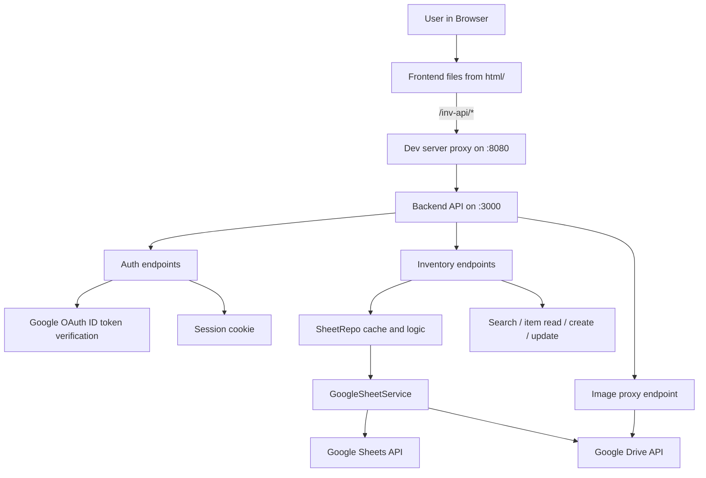

# Architecture

This document explains, in simple English, how the app is built.

## High-level idea

The app has 2 main parts:

- Frontend: static files in `html/` (`index.html`, `index.js`, `index.css`)
- Backend: Node.js API in `backend/server.js`

Inventory data is stored in Google Sheets. Images are stored in Google Drive.

## Main components

- Browser UI
  - Shows search page and item detail page (`/search`, `/i/:id`)
  - Calls API endpoints through `/inv-api/*`
  - Handles Google Sign-In
- Dev Server (`dev-server.js`)
  - Serves frontend files on port `8080`
  - Proxies `/inv-api/*` requests to backend on port `3000`
- Backend API (`backend/server.js`)
  - Handles auth, search, item read/create/update, version/config
  - Verifies Google ID token and creates session cookie
  - Uses repository layer for inventory operations
- Google service layer (`backend/googleSheetService.js`)
  - Connects to Google APIs using service account `credentials.json`
  - Creates Sheets + Drive clients
- Repository (`backend/sheetRepo.js`)
  - Loads rows from Google Sheet into in-memory cache
  - Parses values and supports query search
  - Writes item create/update back to sheet

## Runtime flow

## API groups

Backend API currently exposes these groups:

- Utility
  - `GET /version`
  - `GET /config`
- Authentication
  - `POST /auth/google`
  - `GET /auth/me`
  - `POST /auth/logout`
- Inventory
  - `GET /search?q=...`
  - `GET /item/:id`
  - `POST /item`
  - `PATCH /item/:id`
- Media proxy
  - `GET /images/drive/:fileId`

## Data model source

The inventory schema is defined in backend code (`INVENTORY_HEADERS` in `backend/server.js`).
This drives how rows are parsed and validated (id, text, enum, number, user, dates, photo, etc.).

## Config and credentials

- App config: `config.js`
  - Spreadsheet id, sheet gid, enums, Google client id
- Service account key file: `credentials.json`
  - Used by backend for Google Sheets/Drive access
  - Not committed to git
